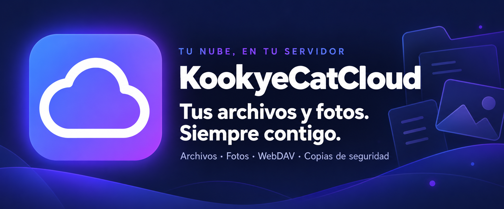

<p align="center">
  
</p>

<h1 align="center">KookyeCatCloud</h1>

<p align="center">
  <strong>Tu nube, en tu servidor.</strong><br>
  Organiza tus archivos, guarda tus fotos y compártelos desde cualquier dispositivo.<br>
  Servidor de archivos y backup de fotos autoalojado, con una PWA instalable.
</p>

<p align="center">
  <a href="LICENSE"></a>
  <a href="public/manifest.json"></a>
  <a href="#despliegue-en-el-vps"></a>
</p>

<p align="center">
  
  
  
  
  
  <a href="#webdav"></a>
</p>

<p align="center">
  
  
  
  
  
  
  
  
</p>

<h3 align="center"><a href="#instalación">🚀 Instalar KookyeCatCloud</a></h3>

<p align="center">
  <a href="#qué-puedes-hacer">Funciones</a> ·
  <a href="#instalación">Instalación</a> ·
  <a href="#variables-de-entorno">Configuración</a> ·
  <a href="#actualizaciones">Actualizar</a> ·
  <a href="#seguridad">Seguridad</a> ·
  <a href="#estructura-del-proyecto">Estructura</a> ·
  <a href="#solución-de-problemas">Problemas</a> ·
  <a href="https://github.com/DavidJLlanes/KookyeCatCloud/issues">Reportar un problema</a>
</p>

---

**Tecnologías:** Node.js · Express 4 · JavaScript vanilla (sin framework ni paso de build) · PWA
(service worker, instalable en iPhone, Android y escritorio) · almacenamiento en archivos y JSON
(sin base de datos) · WebDAV · WebAuthn/passkeys · AES-256-GCM + scrypt · iCalendar (RFC 5545) ·
TOTP (RFC 6238) · sharp (WebP/HEIC) · exifr · exceljs · Leaflet + OpenStreetMap ·
ffmpeg y LibreOffice opcionales · systemd + Nginx.

**Etiquetas:** `self-hosted` `nextcloud-alternative` `file-server` `photo-backup` `pwa` `webdav`
`notes` `calendar` `ical` `prompt-manager` `passkeys` `webauthn` `encrypted-vault` `nodejs` `express`

## Contenido

- [Qué puedes hacer](#qué-puedes-hacer)
- [Instalación](#instalación) — [local](#arrancar-en-local) · [VPS paso a paso](#despliegue-en-el-vps) · [dominio, subdominio o subcarpeta](#en-qué-dirección-instalarla)
- [Funciones en detalle](#miniaturas) — archivos y fotos, [notas](#notas-editor-de-bloques), [calendario](#calendario), [prompts](#prompts-de-ia), [contactos](#contactos), [visor con zoom](#visor-con-zoom), [passkeys](#huella-y-face-id-passkeys), [caja fuerte](#caja-fuerte), [compartir](#compartir-con-usuarios), [actualización en directo](#actualización-en-directo)
- [Actualizaciones](#actualizaciones)
- [Variables de entorno](#variables-de-entorno)
- [Seguridad](#seguridad) · [Copias de seguridad](#copias-de-seguridad) · [Estructura del proyecto](#estructura-del-proyecto) · [Solución de problemas](#solución-de-problemas)

---

## Qué puedes hacer

| | |
| --- | --- |
| 📁 **Archivos organizados** | Gestiona carpetas, favoritos, papelera y descargas ZIP. |
| 📷 **Tu biblioteca de fotos** | Explora álbumes, línea de tiempo, álbumes inteligentes (año, cámara, lugar), datos EXIF y un mapa de fotos. Los álbumes se descargan en ZIP y se comparten con un enlace. |
| 🎬 **Vistas previas** | Consulta fotos, vídeos, audio y documentos desde el navegador, con zoom en las imágenes. |
| 🔗 **Compartir fácilmente** | Crea enlaces de subida y descarga con caducidad y contraseña opcional para las descargas. |
| 💻 **Acceso con WebDAV** | Conecta tu nube desde el explorador o una app compatible. |
| 📝 **Notas tipo Notion** | Editor de bloques con carpetas, colores, etiquetas y enlaces internos. |
| 🛒 **Lista de la compra** | Catálogo y compras compartidos, cantidades, categorías e imágenes con recorte cuadrado. |
| 📅 **Calendario** | Mes, semana, día y agenda con calendarios de colores, repetición y recordatorios. |
| ✨ **Prompts de IA** | Biblioteca con categorías, etiquetas, variables, imágenes de muestra, comparación de versiones, estadísticas y creación desde PNG de ComfyUI / Automatic1111. |
| 👤 **Contactos** | Agenda al estilo Google Contacts: varios teléfonos, correos, direcciones, webs y fechas, con importación y exportación `.vcf`. |
| 📋 **Portapapeles compartido** | Deja texto o archivos desde un dispositivo y recógelos desde otro al instante. En Android, la app aparece en el menú «Compartir». |
| ⚡ **Actualización en directo** | La lista de archivos se refresca sola cuando llega algo por un enlace de subida o desde otro dispositivo, sin consultas periódicas. |
| 🔎 **Todo conectado** | Buscador global (Ctrl+K) y fechas de calendario para lo que subes o creas. |
| 🫆 **Huella y Face ID** | Entra sin contraseña con la biometría de tu móvil u ordenador (passkeys). |
| 🔒 **Caja fuerte** | Archivos cifrados con una contraseña propia, que se bloquea sola. |
| 👥 **Compartir** | Carpetas y archivos entre usuarios, de solo lectura o con edición; versiones de archivos de texto. |
| 🔐 **Control de tu cuenta** | Gestiona sesiones, verificación en dos pasos y tokens de aplicación. |
| 📲 **Instalable en el móvil** | PWA para iPhone y Android, con aviso cuando hay una versión nueva. |
| 🔄 **Calendario sincronizable** | Suscripción iCal de solo lectura, importación de `.ics` y festivos de España. |
| 🌐 **Cualquier dirección** | Dominio, subdominio o subcarpeta (`BASE_PATH`), sin tocar el código. |
| ♻️ **Autoactualización** | Script con vuelta atrás automática y temporizador systemd opcional. |

Licencia [MIT](LICENSE): úsalo, modifícalo o redistribúyelo libremente, con o sin fines
comerciales, siempre que mantengas el aviso de copyright.

## Instalación

**Requisitos:** Node.js 20.9 o superior y npm. Opcionales: `ffmpeg` (miniaturas de vídeo) y
`libreoffice` (vista previa de documentos Office). En producción, un VPS Linux con systemd,
Nginx y un certificado HTTPS (necesario para la PWA, las passkeys y WebDAV desde Windows).

### Arrancar en local

```bash
git clone https://github.com/DavidJLlanes/KookyeCatCloud.git
cd KookyeCatCloud
npm install
INSECURE_COOKIES=1 DATA_DIR=./storage npm start
```

Abre `http://localhost:4000`. En el primer arranque se crea el usuario `admin` y su
contraseña se imprime **una sola vez** en la consola; cámbiala desde la pestaña **Cuenta**.

`INSECURE_COOKIES=1` es necesario en local porque la cookie de sesión lleva el flag
`Secure` y el navegador la descartaría sobre `http://`.

### Despliegue en el VPS

Ejemplo con la app en `/opt/filecloud` y los datos en `/data/storage` (cambia las rutas a tu gusto;
p. ej. `/var/www/tu-dominio/cloud`). Los pasos, en orden:

```bash
# 1. Node.js 20 o superior (Debian/Ubuntu)
curl -fsSL https://deb.nodesource.com/setup_20.x | bash - && apt install -y nodejs git

# 2. Código
git clone https://github.com/DavidJLlanes/KookyeCatCloud.git /opt/filecloud
cd /opt/filecloud

# 3. Dependencias (como root: el usuario del servicio no tiene carpeta personal)
npm ci --omit=dev

# 4. Configuración
cp .env.example .env      # y rellena JWT_SECRET con: openssl rand -hex 32
nano .env                 # DATA_DIR, PORT, BASE_PATH, ADMIN_PASSWORD…
```

Después crea el usuario, el servicio (siguiente apartado) y el bloque de Nginx. Al terminar,
abre la dirección: el usuario `admin` se crea en el primer arranque y su contraseña (la de
`ADMIN_PASSWORD` o una aleatoria) aparece en `journalctl -u filecloud -n 50`.

#### systemd — `/etc/systemd/system/filecloud.service`

El servicio corre con un usuario del sistema sin privilegios, no con `root`:

```bash
useradd --system --no-create-home --shell /usr/sbin/nologin filecloud
mkdir -p /data/storage
chown -R filecloud:filecloud /data/storage /opt/filecloud
```

```ini
[Unit]
Description=KookyeCatCloud
After=network.target

[Service]
Type=simple
User=filecloud
WorkingDirectory=/opt/filecloud
EnvironmentFile=/opt/filecloud/.env
ExecStart=/usr/bin/node server.js
Restart=on-failure
NoNewPrivileges=true
PrivateTmp=true
ProtectSystem=strict
ProtectHome=true
ReadWritePaths=/data/storage /opt/filecloud

[Install]
WantedBy=multi-user.target
```

`ProtectSystem=strict` deja todo el sistema de archivos en solo lectura salvo lo indicado en
`ReadWritePaths`: si cambias `DATA_DIR` en el `.env` a una ruta distinta de `/data/storage`,
actualiza también esta línea o el servicio no podrá escribir ahí.

```bash
systemctl daemon-reload && systemctl enable --now filecloud
```

#### Nginx

```nginx
server {
    listen 443 ssl http2;
    server_name tu-dominio.com;

    ssl_certificate     /etc/letsencrypt/live/tu-dominio.com/fullchain.pem;
    ssl_certificate_key /etc/letsencrypt/live/tu-dominio.com/privkey.pem;

    # Las subidas llegan hasta 5 GB: sin esto Nginx corta en 1 MB
    client_max_body_size 5G;
    proxy_read_timeout 600s;
    proxy_request_buffering off;

    location / {
        proxy_pass http://127.0.0.1:4000;
        proxy_set_header Host              $host;
        proxy_set_header X-Real-IP         $remote_addr;
        proxy_set_header X-Forwarded-For   $proxy_add_x_forwarded_for;
        proxy_set_header X-Forwarded-Proto $scheme;
    }
}

server {
    listen 80;
    server_name tu-dominio.com;
    return 301 https://$host$request_uri;
}
```

`X-Forwarded-For` importa: el servidor tiene `trust proxy` activado y el limitador de
intentos de login usa la IP real del cliente.

Certificado gratuito con Let's Encrypt: `apt install certbot python3-certbot-nginx && certbot --nginx -d tu-dominio.com`.

#### En qué dirección instalarla

La app no lleva ningún dominio escrito: todo se calcula a partir de la dirección desde la que
la abres, así que sirve igual en `djl.com.es`, en `davidjllanes.es` o en un subdominio como
`cloud.davidjllanes.es`. Para esos casos basta el bloque de Nginx de arriba cambiando
`server_name` (y el certificado).

Para colgarla de una **subcarpeta** (`davidjllanes.es/cloud`) define el prefijo en el `.env`:

```ini
BASE_PATH=/cloud
```

y en el `server` de ese dominio añade un `location` que **conserve** el prefijo (sin barra
final en `proxy_pass`):

```nginx
    location ^~ /cloud/ {
        proxy_pass http://127.0.0.1:4000;
        proxy_set_header Host              $host;
        proxy_set_header X-Real-IP         $remote_addr;
        proxy_set_header X-Forwarded-For   $proxy_add_x_forwarded_for;
        proxy_set_header X-Forwarded-Proto $scheme;
    }
    location = /cloud { return 301 /cloud/; }
```

Con `BASE_PATH` la app, el manifest de la PWA, el service worker, la cookie de sesión, los
enlaces compartidos (`/cloud/s/…`, `/cloud/u/…`) y WebDAV (`/cloud/dav/`) cuelgan todos de
ese prefijo. Fuera de él el servidor responde 404. Cada instalación necesita su propio
proceso, puerto y `DATA_DIR`.

`^~` evita que otro `location` de expresión regular del mismo dominio (por ejemplo uno que sirva
estáticos como `.js` o `.css`) se adelante y deje de pasar las peticiones a Node. Tras instalarla
comprueba que `https://tu-dominio.com/cloud/.env` **no** devuelve el archivo.

## Miniaturas

La cuadrícula de fotos pide `/api/thumb`, que genera un WebP de 480 px con **sharp** y lo
cachea en `.thumbs/` (fuera de `DATA_DIR`, para que no aparezca en los listados). La clave de
caché incluye tamaño y `mtime`, así que al reemplazar una foto su miniatura se regenera sola.

`sharp` está declarado como dependencia **opcional** y necesita **Node ≥ 20.9**. Si no se
instala, la app sigue funcionando: la cuadrícula muestra las imágenes originales, solo que
descargando muchos más bytes. Para comprobarlo:

```bash
node -e "console.log(require('sharp').versions)"
```

La caché se puede borrar en cualquier momento, se reconstruye sola:

```bash
rm -rf /opt/filecloud/.thumbs/*
```

## Multimedia

| Formato | Miniatura | Reproducción |
|---|---|---|
| Imágenes (jpg, png, webp, gif, bmp, avif) | sharp | directa |
| **HEIC/HEIF** (fotos de iPhone) | sharp | convertida a WebP al vuelo y cacheada |
| **Vídeo** (mp4, mov, mkv, webm, m4v, ogv) | fotograma con ffmpeg | `<video>` con salto por rangos |
| **Audio** (mp3, m4a, flac, wav, ogg, opus, aac) | — (distintivo) | `<audio>` |

El salto en el vídeo funciona porque el servidor de ficheros de Express ya responde `206 Partial
Content`. Para las miniaturas de vídeo hace falta ffmpeg en el servidor:

```bash
apt install ffmpeg
```

Sin él, los vídeos salen con su distintivo de color y todo lo demás sigue igual. `DISPLAY_MAX`
(2200 px por defecto) limita el tamaño de la conversión HEIC para pantalla.

## Fotos: agrupación y EXIF

El botón del calendario, junto al selector de vista, agrupa por **mes y año** con una cabecera por
grupo; el año se destaca solo cuando cambia. Se vuelve a "todas seguidas" con el mismo botón, y la
preferencia se recuerda en el dispositivo. Las carpetas van en su propio grupo, arriba.

La fecha que manda es la de **captura del EXIF**, no la del archivo: subir hoy una foto de 2019 no
debe colocarla en el mes actual. Si una foto no trae EXIF, se usa su fecha de archivo.

Leer el EXIF de cientos de fotos en cada listado sería insufrible, así que `GET /api/photometa`
cachea fecha y coordenadas en `.thumbs/exif-cache.json`, con la misma clave que las miniaturas
(ruta + tamaño + mtime). La primera vez tarda; después responde en milisegundos. La rejilla se
pinta antes de pedirlas y se reordena cuando llegan.

En el visor, el botón de información abre el panel de detalles de la foto: fecha, cámara, objetivo,
exposición (0,004 s se muestra como 1/250), diafragma, ISO, focal, dimensiones y software. Si la
foto guarda coordenadas, aparece un enlace a **Google Maps** y las coordenadas en decimal.

Se lee con **exifr** (sin dependencias propias). Esa misma caché de coordenadas es la que
aprovecha el mapa de fotos (siguiente sección) para no releer el EXIF de todo el árbol.

## Línea de tiempo y álbumes inteligentes

En **Colecciones** hay dos pestañas nuevas que trabajan sobre *todas* las fotos de tu nube, estén en la
carpeta que estén:

- **Línea de tiempo**: las fotos ordenadas por fecha de captura (EXIF), agrupadas por mes, con filtros
  por año, cámara y «con ubicación». Se pintan por tramos mientras haces scroll, así que aguanta
  bibliotecas grandes. El botón *Guardar como álbum* convierte lo que estás viendo en un álbum normal.
- **Inteligentes**: tarjetas que se forman solas **por año**, **por cámara** y **por lugar**, más dos
  grupos para revisar («sin ubicación» y «sin fecha de captura»). Al abrir una se ve su cuadrícula y se
  puede guardar como álbum. Los lugares se agrupan por coordenadas (celdas de unos 25 km) y se nombran
  con ellas; hay un enlace para verlos en OpenStreetMap. No se consulta ningún servicio externo.

Las dos usan `GET /api/photoindex`, que devuelve para cada foto su fecha, cámara y coordenadas apoyándose
en la misma caché de EXIF del mapa (`.thumbs/exif-cache.json`): la primera vez tarda si hay miles de
fotos, después es inmediato. La caché de versiones anteriores se relee una vez para añadir la cámara.
Tope de `PHOTOS_INDEX_LIMIT` (50000) fotos, de más recientes a más antiguas.

## Álbumes: ZIP y enlace público

Dentro de un álbum, **ZIP** descarga todas sus fotos en un archivo (`GET /api/albums/<id>/zip`) y
**Compartir** crea un enlace público `/s/<token>` con la misma galería que las carpetas compartidas, con
caducidad y contraseña opcional. En un enlace de álbum no hay rutas: quien lo recibe solo puede pedir
fotos del álbum por su nombre (si dos coinciden se numeran, `foto (2).jpg`), nunca salir de ahí. Si el
álbum se borra, el enlace deja de funcionar. Los enlaces aparecen en *Enlaces* con su tipo y descargas.

## Zonas seguras en móvil

La app declara `viewport-fit=cover` y barra de estado translúcida, así que el contenido llega
hasta los bordes físicos de la pantalla. Para que no quede **debajo** de la barra de estado o de
la barra de gestos, los márgenes salen de cuatro variables:

```css
--safe-top: env(safe-area-inset-top, 0px);
--safe-bottom: env(safe-area-inset-bottom, 0px);
--safe-left / --safe-right
```

Se usan en la cabecera (que crece lo que ocupe la barra de estado), la pantalla de entrada, el
visor, las ventanas, el panel de detalles, las barras flotantes y la navegación inferior. En un
equipo sin muesca valen 0 y no cambia nada.

Van por variable y no por `env()` suelto a propósito: así se pueden **simular** en una prueba
—redefiniéndolas a 47 px— y medir si algo se solapa, que es como se verificó.

El botón de cerrar del visor mide 48×48 en móvil, va destacado sobre el resto y nunca lo tapa el
nombre del archivo, por largo que sea.

## Mapa de fotos

Pestaña **Mapa** con las fotos que guardan coordenadas, sobre Leaflet + OpenStreetMap.

Leaflet va **alojado aquí** (`public/vendor/leaflet/`, 185 KB): ningún CDN. Lo único que sale
fuera son los tiles del mapa, y por eso `img-src` de la CSP incluye el servidor de tiles —es la
única excepción de toda la aplicación. Se cambia de proveedor con `TILE_URL` y `TILE_ATTR`, y el
permiso de la CSP se deriva solo de esa URL.

Los puntos cercanos se agrupan en círculos con el número de fotos; al acercar se separan. La
agrupación es propia, por rejilla, para no añadir otra librería. El globo muestra miniatura,
nombre, fecha y carpeta, con un botón que abre la foto en el visor, navegando por todas las
fotos ubicadas ordenadas por fecha.

`GET /api/photomap` recorre el árbol entero reutilizando la caché de EXIF, así que la segunda
vez es inmediato. Tope de `MAP_LIMIT` (5000) fotos.

Sobre privacidad: tus fotos y tus coordenadas **no** salen de tu servidor. El servidor de tiles
solo sabe qué cuadrantes del mapa pides, como cualquier mapa web.

## Visor de documentos

| Tipo | Cómo se muestra |
|---|---|
| **PDF** | visor propio del navegador, en un marco |
| **Markdown** | intérprete propio (ver abajo) |
| **Texto y código** (txt, json, log, js, css, py, yml…) | monoespaciado, con tope de `TEXT_MAX` |
| **CSV / TSV** | tabla, hasta 500 filas |
| **Hojas de cálculo** (xlsx, xlsm, xls, ods) | rejilla de verdad: columnas, filas y pestañas de hoja |
| **Documentos y presentaciones** (docx, doc, pptx, ppt, odt, odp, rtf) | convertidos a PDF con LibreOffice y cacheados |

Las hojas de cálculo **no** se convierten a PDF: eso las pagina y dejan de parecer una hoja.
Se leen con **exceljs** y se devuelven como datos, y el cliente pinta la rejilla con letras de columna,
números de fila, cabeceras fijas al desplazar y una pestaña por hoja. Solo lectura. Se muestran los
valores ya calculados de las fórmulas, las fechas en formato español y los anchos de columna del
original. Topes: `SHEET_MAX_ROWS` (2000) y `SHEET_MAX_COLS` (60), con aviso si se recorta.

Los `.xls` y `.ods` antiguos no los abre exceljs: LibreOffice los pasa a xlsx primero y el
resultado queda cacheado.

Para los documentos de Office hace falta LibreOffice en el servidor:

```bash
apt install -y libreoffice --no-install-recommends
```

Sin él, esos archivos muestran un aviso claro y el botón de descarga; todo lo demás funciona igual.
Cada conversión usa un perfil de usuario propio (`-env:UserInstallation`) porque dos LibreOffice
a la vez con el mismo perfil chocan. `GET /api/capabilities` dice qué hay disponible, y el cliente
lo usa para no prometer una vista previa que no existe.

El intérprete de Markdown es propio y **devuelve nodos del DOM, nunca cadenas de HTML**: un archivo
que contenga `<script>` se ve como texto, no se ejecuta. Cubre encabezados, negrita, cursiva,
tachado, código en línea y en bloque, listas con un nivel de anidado, citas, reglas, tablas y
enlaces (solo `http`, `https` y `mailto`, con `rel="noopener noreferrer"`).

De los archivos grandes solo se lee el principio (`TEXT_MAX`, 512 kB por defecto): un log de 2 GB
no puede tumbar el servidor. El visor avisa de que está recortado.

Nota sobre el PDF: se sirve **sin** la directiva `sandbox` que llevan las demás vistas previas,
porque el visor del navegador no arranca dentro de un documento aislado. Corre en su propio
proceso y no tiene acceso a la sesión.

## WebDAV

`https://tu-dominio.com/dav/` con tu usuario y contraseña de siempre. Cada uno ve su propia
raíz, igual que en la web, y las carpetas internas (`.trash`, `.notes`) quedan fuera.

- **Windows** — Explorador → Este equipo → Conectar a unidad de red
- **macOS** — Finder → Ir → Conectarse al servidor (⌘K)
- **Android** — FolderSync o similar, para que el móvil suba las fotos solo

Métodos: OPTIONS, PROPFIND, GET/HEAD, PUT, DELETE, MKCOL, MOVE, COPY, PROPPATCH y LOCK/UNLOCK.
Los bloqueos son simbólicos: se conceden y se recuerdan pero no impiden nada. Se anuncian porque
sin ellos Windows monta la unidad en solo lectura.

Va montado **antes** del analizador de JSON a propósito: si no, un cliente que suba un `.json`
con `Content-Type: application/json` haría que Express se comiera el cuerpo y el PUT escribiera
un archivo vacío. La comprobación de contraseña con bcrypt se cachea 5 minutos porque montar una
unidad dispara decenas de peticiones seguidas.

Dos cosas de Windows que conviene saber: exige HTTPS con certificado válido para autenticación
básica (aquí lo hay), y trae un límite de 50 MB por descarga que se sube en el registro
(`HKLM\SYSTEM\CurrentControlSet\Services\WebClient\Parameters\FileSizeLimitInBytes`).

## Espacio de trabajo: notas, calendario, prompts y contactos

Cuatro módulos que comparten **etiquetas de color**, **fechas de calendario** y el **buscador
global**. Todo lo que subes o creas puede llevar una fecha, y esa fecha aparece como evento
en el calendario con un enlace de vuelta al elemento.

| Módulo | Qué guarda | Dónde |
| --- | --- | --- |
| Notas | Un `.md` por nota + `index.json` con la estructura | `<usuario>/.notes/` |
| Calendario | Calendarios, eventos y tareas | `<usuario>/.kcc/calendar.json` |
| Prompts | Un `.json` por prompt + imágenes WebP | `<usuario>/.kcc/prompts/` |
| Contactos | Todos los contactos en un solo archivo | `<usuario>/.kcc/contacts.json` |
| Etiquetas | Lista de etiquetas con color | `<usuario>/.kcc/labels.json` |

Todo está oculto al explorador de archivos y a WebDAV (son carpetas con punto). Para las
copias de seguridad basta con respaldar `DATA_DIR`.

### Etiquetas de color

Se escriben donde haga falta (nota, prompt, evento) y se crean al vuelo con Enter. Son las
mismas en todas partes: renombrar una o cambiarle el color lo cambia en todos los módulos a la
vez, y borrarla la quita de todo lo que la usaba. Se gestionan desde el menú “⋯” de Prompts o de Contactos, el
panel de etiquetas del Calendario o el buscador (Ctrl+K → “Gestionar etiquetas”).

### Buscador global (Ctrl+K)

Un solo cuadro que busca en archivos, notas (título y contenido), prompts, contactos y eventos, y que
también crea cosas (“Nuevo prompt”, “Nuevo contacto”, “Nuevo evento”…) y salta entre secciones. Se abre con
**Ctrl+K** (⌘K en Mac) o desde el botón de la barra lateral.

### Fecha en el calendario

- **Al subir archivos**: en la barra de subida hay un interruptor *“Poner fecha de subida en
  el calendario”*. Con pocos archivos cada uno tiene su evento; con una subida grande se crea
  un solo evento para la carpeta. El interruptor se recuerda; la fecha vuelve a ser “hoy” en
  cada subida.
- **En un archivo ya subido**: menú del archivo → *“Fecha en el calendario…”* (poner,
  cambiar o quitar). Si el archivo se renombra o se mueve, el evento lo sigue; si va a la
  papelera, el evento desaparece.
- **En un prompt o una nota**: interruptor en el editor / propiedades de la nota.
- **Desde el calendario**: mover un evento de un prompt o una nota (arrastrándolo o
  editándolo) actualiza la fecha en su ficha, y borrarlo la quita de la ficha. Pulsar el
  origen en el evento abre el prompt, la nota o la carpeta del archivo.

Los eventos nacidos de un origen van a calendarios de sistema (*Prompts*, *Notas*,
*Archivos*) que se pueden recolorear o ocultar, pero no borrar.

## Calendario

Vistas **mes, semana, día y agenda**; varios calendarios con color; eventos de día completo,
multidía y **tareas** con casilla; **repetición** (diaria, semanal con días, mensual, anual,
hasta una fecha o N veces) y edición de “solo este evento” o “todos”; **recordatorios** (avisos
en la propia app y notificación del navegador si das permiso); lugar, descripción, etiquetas y
color propio por evento.

- **Arrastrar** una pastilla en la vista mes la mueve de día; en semana/día se arrastra para
  mover (también a otro día), con el borde inferior para cambiar la duración, y arrastrando en
  un hueco vacío se crea un evento con ese rango.
- Las fechas se guardan **sin zona horaria**, tal y como las ves: un evento “a las 9:00” sigue
  siendo a las 9:00 aunque cambie el horario de verano.
- Mini-calendario lateral con puntos en los días con eventos, filtro por etiquetas y búsqueda.
- **Tareas sin fecha**: una lista lateral donde apuntas tareas sin día ni hora. Se arrastran a un
  día (todo el día) o a una hora de la vista semana/día para programarlas, y de vuelta a la lista
  para quitarles la fecha.
- **Festivos de España**: calendario opcional (menú “⋯” → *Festivos de España…*) con los festivos
  nacionales y los de tu comunidad autónoma. Se calculan para cualquier año (la Semana Santa sale
  de la fecha de Pascua), sin servicios externos. Son orientativos: cada comunidad publica su
  calendario oficial y los festivos locales no están incluidos.
- **Importar .ics** (Google Calendar, Apple, Outlook…): se interpreta en el navegador, así que las
  horas en UTC o con zona horaria pasan a tu hora local. Admite eventos y tareas, todo el día,
  repeticiones (diaria, semanal con días, mensual, anual), excepciones, instancias modificadas y
  avisos. Volver a importar el mismo archivo no duplica nada.
- **Suscripción iCal de solo lectura** (menú “⋯” → *Suscribirse desde otro calendario…*): genera un
  enlace privado `…/ical/<token>.ics` para ver tu calendario en Google Calendar, Apple Calendar u
  Outlook. El token es de 256 bits, se puede regenerar o apagar, y puedes elegir qué calendarios
  incluir. Google actualiza estos enlaces cada cierto número de horas.

## Prompts de IA

Biblioteca pensada para guardar muchos prompts (aguanta decenas de miles: el índice vive en
memoria y cada prompt es un archivo propio).

- **Clasificación**: categorías en **árbol** (con emoji y color), **listas** (agrupan prompts de
  cualquier categoría: un proyecto, un cliente), etiquetas de color, **tipo** (imagen, texto,
  código, vídeo, audio, agente), **estado** (borrador / probando / final / archivado), **modelo** (GPT, Claude, FLUX…) y **herramienta** (Midjourney, ComfyUI, Cursor…) por separado,
  idioma, valoración de 1 a 5, favorito, fijado y color de tarjeta.
- **Imágenes de muestra**: hasta **10 por prompt**. Se convierten a **WebP**, se reducen a
  **1600 px** como máximo por el lado mayor y se genera una miniatura de 480 px. Se pueden
  arrastrar, pegar (Ctrl+V), reordenar, elegir portada y poner pie de foto. Requiere `sharp`
  (ver *Miniaturas*). Máximo 15 MB y 64 megapíxeles por imagen de origen.
- **Variables y plantillas con formulario**: al copiar, la app abre un formulario con un campo por
  variable y una vista previa del resultado. Sintaxis dentro del texto:
  `{{nombre}}` (campo de texto) · `{{nombre=valor}}` (con valor por defecto) ·
  `{{tono=formal|cercano|técnico}}` (lista desplegable; la primera opción es la predeterminada) ·
  `{{detalle:largo}}` (varias líneas; también `:numero` y `:fecha`). Una variable repetida se
  pide una sola vez, se rellena también en el prompt negativo y la app recuerda los últimos
  valores de cada prompt.
- Prompt negativo, notas, parámetros (seed, steps, aspect ratio…) y fuente.
- **Historial** de versiones del texto (las 30 últimas) para volver atrás, y **Comparar versiones**:
  eliges dos versiones (o la actual) y se marcan por palabras lo quitado y lo añadido en título, prompt
  y prompt negativo.
- **Crear desde imágenes de ComfyUI / Automatic1111** (menú ⋯): eliges hasta 20 PNG y se crea un prompt
  por imagen leyendo los metadatos que llevan dentro. De **ComfyUI** se sigue el workflow desde el
  muestreador (KSampler, SamplerCustom, Flux…) hasta los nodos de texto y el cargador del modelo:
  prompt, negativo, modelo, semilla, pasos, CFG, sampler, scheduler, tamaño y LoRA. De **Automatic1111 /
  Forge** se lee el bloque `parameters`. La imagen queda de muestra (WebP) y el nombre del archivo como
  fuente. Los PNG sin datos (pasados por redes sociales, JPG…) se saltan. Solo se lee JSON: no se
  ejecuta nada del workflow.
- **Estadísticas** (menú ⋯): totales, valoración media, los más copiados, los que no usas, creados por
  mes y reparto por herramienta, modelo, tipo, estado, categoría, etiqueta y lista. Las filas de
  herramienta, modelo, tipo y estado filtran la biblioteca al pulsarlas.
- **Vistas** en tarjetas, lista o **tablero por estado** (arrastrando entre columnas), orden por
  fecha, título, valoración o uso, filtros combinables, **selección múltiple** con acciones en
  lote y **papelera** con restauración.
- **Ficha con propiedades**: categoría, listas, tipo, estado, modelo, herramienta y etiquetas van
  en filas con su título, y cada valor es un botón que filtra la biblioteca por él.
- **Importar / exportar** en JSON (hasta 5000 por importación), o pegando texto con prompts
  separados por una línea `---`.

### Prompts que no son de imagen

La ficha se adapta al **tipo** (Imagen, Texto, Código, Vídeo, Audio, Agente, Fragmento, Otro):

- **Mensaje de sistema** (texto, código, agente, otro) además del mensaje de usuario; el prompt
  negativo solo aparece en imagen, vídeo y audio; los parámetros sugieren nombres según el tipo
  (`temperature`, `seed`, `fps`…). Una **estimación de tokens** (≈ 4 caracteres por token) se ve
  al editar y en la ficha.
- **Plantillas de inicio**: rol-tarea-contexto-formato, resumir, razonar paso a paso, extraer JSON,
  reescribir, revisión de código, agente con herramientas y descripción de imagen.
- **Fragmentos reutilizables**: crea prompts de tipo *Fragmento* (roles, reglas, estilos) y úsalos en
  cualquier otro con `{{@nombre-del-titulo}}`. Se sustituyen al copiar, exportar y compartir
  (hasta 3 niveles). El botón **@ Fragmento** del editor los inserta.
- **Rellenar y copiar**: las `{{variables}}` también valen en el mensaje de sistema; el formulario
  muestra sistema y usuario y copia cada uno por separado.
- **Resultados guardados**: por prompt, hasta 30 respuestas con modelo, entrada de prueba,
  valoración y marca de **la mejor**; botón **Comparar** para verlas en columnas.
- **Cadenas**: un prompt puede enlazar hasta 20 pasos; **Ejecutar cadena** los muestra uno a uno
  para copiarlos en orden.
- **Parecidos**: al guardar avisa si ya existe un prompt con ≥ 60 % de palabras en común, y la ficha
  lista los parecidos.
- **Vistas guardadas**: en la barra lateral, `+` guarda la búsqueda y los filtros actuales con un nombre.
- **Exportar** (menú ⋯, ficha o selección): JSON (reimportable), Markdown o *instrucciones
  personalizadas* (texto listo para ChatGPT, Proyectos de Claude, GPTs o Gems).
- **Compartir con enlace**: página pública de solo lectura `/p/<id>` (sin iniciar sesión) con botón de
  copiar por bloque; caduca en 7/30/90 días o nunca, se revoca desde el mismo diálogo y tiene límite
  de peticiones. Se comparten texto, parámetros y notas, no las imágenes ni los resultados.
- **Enviar a ComfyUI** (opcional): con `COMFY_URL` definida, el menú ⋯ → *Workflow de ComfyUI…*
  guarda un workflow (formato API) con marcadores `%PROMPT%`, `%NEGATIVE%`, `%SEED%` y
  `%P:parametro%`; en la ficha de un prompt de imagen, **Generar en ComfyUI** añade el resultado
  como imagen del propio prompt. Tiempo máximo: `COMFY_TIMEOUT_S` (240 s por defecto).

## Contactos

Agenda personal al estilo de Google Contacts, en la pestaña **Contactos** (barra lateral en el
ordenador, barra inferior en el móvil).

- **Campos**: nombre, segundo nombre, apellidos, apodo, empresa, cargo y departamento; **varios**
  teléfonos, correos, direcciones, sitios web y fechas (cumpleaños, aniversario u otra, con o
  sin año), cada uno con su etiqueta (Móvil, Trabajo, Casa…); notas y favorito. Basta con un
  nombre, una empresa, un teléfono o un correo para guardar un contacto.
- **Lista**: agrupada por inicial, ordenable por nombre o apellido, con avatar de color, búsqueda
  instantánea (sin acentos; por nombre, empresa, correo, notas, dirección o dígitos del
  teléfono) y filtros por **Favoritos** y por **etiqueta**. Atajos: `/` para buscar, `n` para
  crear.
- **Ficha**: botones de llamar y escribir, enlace “Ver en el mapa” en las direcciones, copiar cada
  dato y menú con favorito, exportar y eliminar. Las webs solo se enlazan si empiezan por
  `http://` o `https://`.
- **Foto**: cada contacto puede llevar una foto. Se recorta y se reduce en el servidor a **300×300 en WebP** (el original no se guarda) y se muestra como avatar; sin foto salen las iniciales sobre un color. Se guarda en `<usuario>/.kcc/contact-photos/`. Las fotos que se suben en **Archivos** no se tocan: se guardan con su resolución original.
- **Etiquetas**: son las mismas de notas, prompts y calendario.
- **Importar y exportar vCard (`.vcf`)**: importa archivos de Google Contacts, iCloud y Android
  (vCard 3.0 y variantes habituales; las categorías pasan a etiquetas y las fotos incrustadas se reducen igual) sin duplicar los contactos
  que ya tienes —mismo nombre y algún teléfono o correo en común—. Exporta todos o uno solo, con la foto incluida.
- **Buscador global**: Ctrl+K encuentra contactos y ofrece “Nuevo contacto”.

API (`/api/contacts`, requiere sesión): `GET /`, `GET /search?q=`, `GET /export[?ids=a,b]`,
`POST /import` (cuerpo: texto del `.vcf`, hasta 8 MB), `GET|PUT|DELETE /:id/photo` (el `PUT` recibe la imagen tal cual, hasta 15 MB), `POST /`, `PUT /:id` y `DELETE /:id`.
Límite de `CONTACTS_LIMIT` contactos por usuario (10000 por defecto).

## Visor con zoom

Las fotos de la galería y las imágenes de muestra de los prompts se abren en un visor a pantalla
completa con zoom: **rueda del ratón** o **pellizco con dos dedos** (de 1× a 8×), **doble toque o
doble clic** para acercar y alejar, y arrastre para moverte por la imagen ampliada. Con la imagen
sin ampliar, deslizar un dedo cambia de foto; en el teclado, `Esc` cierra, las flechas cambian de
imagen, `+` y `-` hacen zoom y `0` lo restablece. Está en `public/js/zoom.js`.

## Móvil: desplazamiento y tamaños táctiles

Las ventanas altas (como el detalle de un prompt) se desplazan con el dedo y llevan un botón de
cerrar fijo arriba. La barra inferior usa iconos de 26 px y botones de al menos 78×60 px, se
desliza hacia los lados y centra sola la pestaña activa; el resto de botones tiene una zona táctil
mínima de 44 px. La página no se puede ampliar con el pellizco (la interfaz ya se adapta a cada
pantalla) y los campos de texto usan 16 px para que iOS no haga zoom al enfocarlos; el zoom
sigue disponible dentro del visor de fotos.

## Notas (editor de bloques)

Editor estilo Notion sobre las mismas carpetas y el mismo autoguardado de siempre.

- **Bloques**: texto, títulos 1-3, listas con viñetas, numeradas y de tareas (anidables con
  Tab), citas, código, avisos de colores y separadores. Escribe **`/`** para insertar, o usa
  atajos de Markdown (`# `, `- `, `1. `, `[] `, `> `, tres comillas invertidas, `---`).
- **Formato**: negrita, cursiva, tachado, resaltado, código y enlaces (barra flotante al
  seleccionar, o Ctrl+B / I / E / K). Arrastra el asa ⠿ para reordenar bloques.
- **Enlaces internos**: `/Enlazar un prompt` y `/Enlazar una nota` insertan un enlace que
  abre el prompt o la nota.
- **Tablas** (Tab y Enter recorren las celdas, botones para filas y columnas) e **imágenes**:
  súbelas, pégalas (Ctrl+V), arrástralas o elige una de tus archivos. Se guardan en la carpeta
  *Adjuntos de notas* de tu nube y la nota las referencia, así que no se duplican.
- **Menciones `@`**: escribe `@` y un nombre para enlazar notas, prompts o archivos. Cada nota
  muestra abajo **“Enlazada desde…”** (backlinks), y la ficha de un prompt enseña en qué notas
  se menciona.
- **Plantillas**: reunión, diario, proyecto, planificación semanal y apuntes de lectura, más las
  tuyas (menú ⋯ de una nota → *Guardar como plantilla*).
- **Exportar**: una nota a **Markdown** (si tiene imágenes, un ZIP con `Adjuntos/`), una carpeta a
  un ZIP con su estructura, o a **PDF** (se abre el diálogo de impresión del navegador →
  *Guardar como PDF*; una carpeta junta todas sus notas).
- **Propiedades**: icono (emoji), color, **fijar** arriba, etiquetas y **fecha en el
  calendario**.
- El contenido se guarda como **Markdown** en el mismo `.md`: las notas anteriores se abren
  tal cual y todo sigue siendo texto recuperable a mano.

Notas y carpetas anidadas sin límite de profundidad. Las notas eliminadas van a `.notes/trash/`
y se restauran con su rama entera; caducan a los mismos `TRASH_TTL_DAYS` que los archivos.
`NOTES_LIMIT` (5000) topa el número de elementos y `NOTE_MAX_CHARS` (500 000) el tamaño de una
nota. Las rutas de notas, prompts y calendario aceptan hasta 2 MB de cuerpo (30 MB la
importación de prompts), frente a los 100 kB del resto de la API.

## Huella y Face ID (passkeys)

Entra con **Face ID, Touch ID, la huella del móvil, Windows Hello** o una llave de seguridad, sin
escribir la contraseña. Funciona en iPhone/iPad (Safari y la app instalada, iOS 16+), Android
(Chrome, Edge, Samsung Internet…), Mac y Windows.

- **Activarlo**: *Cuenta → Huella y Face ID → Añadir este dispositivo* (hay que haber entrado antes
  con la contraseña). Cada dispositivo se puede renombrar o quitar. En la pantalla de inicio de
  sesión aparece el botón **“Entrar con huella o Face ID”**. La contraseña sigue funcionando.
- **Seguridad**: la biometría nunca sale del dispositivo; el servidor solo guarda una **clave
  pública** por dispositivo (`passkeys.json`). Se exige siempre verificación del usuario (huella,
  cara o PIN), por eso una passkey cuenta como contraseña + segundo factor y no se pide el código
  de verificación en dos pasos. Cada intento usa un reto de un solo uso (5 min), se comprueban el
  dominio y el origen, la firma, y un contador detecta claves clonadas.
- **Requisitos**: HTTPS (o `localhost`). Las passkeys quedan ligadas al **dominio**: si abres la
  nube en `cloud.ejemplo.es` y en `ejemplo.es/cloud` tendrás que registrar el dispositivo en cada
  dirección. Si la app está detrás de un proxy, Nginx debe enviar `Host` y `X-Forwarded-Proto`
  (ya van en la configuración de ejemplo); en casos raros se pueden fijar con `WEBAUTHN_RP_ID` y
  `WEBAUTHN_ORIGIN`.
- Las passkeys de iPhone y Android se sincronizan con iCloud o con tu cuenta de Google, así que un
  móvil nuevo suele traerlas ya, aunque conviene registrarlo igualmente.
- Los datos de acceso a la caja fuerte **no** se desbloquean con la huella: la caja usa su propia
  contraseña a propósito.

## Versiones de archivos de texto

Cada vez que guardas un archivo de texto desde el editor de la web (o lo sobrescribes por WebDAV)
se guarda antes una copia de lo que había. Menú del archivo → *Historial de versiones…*, o el botón
*Historial* mientras lo editas: lista de versiones, comparación línea a línea con la actual,
descarga y restauración. Restaurar guarda antes lo de ahora, así que siempre se puede deshacer.
Guardar sin cambios no crea versiones. Se conservan las últimas `VERSIONS_KEEP` (30) y se borran
las de más de `VERSIONS_DAYS` (180) días; no se versionan archivos de más de
`VERSIONS_MAX_BYTES` (5 MB). Si renombras o mueves el archivo, sus versiones lo siguen. Viven en
`<usuario>/.kcc/versions/`.

## Caja fuerte

Una sección con **contraseña propia**, distinta a la de la cuenta, para lo realmente privado.

- **Cifrado**: AES-256-GCM por bloques de 1 MiB. La clave sale de tu contraseña con scrypt
  (N=32768) y envuelve una clave de datos aleatoria; cambiar la contraseña solo vuelve a envolver
  esa clave, no recifra nada. Los **nombres** y la estructura de carpetas también están cifrados, y
  cada bloque lleva autenticación: si alguien altera o trunca un archivo en disco, se detecta y no
  se entregan datos falsos.
- **Clave en memoria**: el servidor solo tiene la clave mientras la caja está desbloqueada, ligada
  a tu sesión. Se descarta al bloquear, al cerrar sesión, al salir de la sección (opcional) y tras
  `VAULT_IDLE_MIN` (15) minutos sin usarla. Cinco contraseñas erróneas bloquean los intentos 5 min.
- **Uso**: subir (con barra de progreso y arrastrar y soltar), carpetas, vista previa de
  imágenes, PDF, texto, vídeo y audio (con rangos para saltar en el vídeo), descargar, renombrar,
  mover, **mover desde tus archivos** (se cifran y se borran los originales) y **sacar a tus
  archivos**. También desde el menú de cualquier archivo → *Mover a la caja fuerte…*.
- **Límites a propósito**: los archivos de la caja no aparecen en la búsqueda, ni en WebDAV, ni en
  enlaces compartidos, ni en copias de miniaturas en claro. Los SVG y HTML se descargan en vez de
  abrirse.
- **Si olvidas la contraseña, los datos no se pueden recuperar**, ni siquiera el administrador. La
  caja vive en `<usuario>/.vault/`: haz copia de esa carpeta junto con el resto de `DATA_DIR`.

## Compartir con usuarios

Menú de un archivo o carpeta → *Compartir con usuarios…*: eliges qué usuarios del servidor lo ven y
con qué permiso, **solo ver** o **puede editar**. Quien lo recibe lo encuentra en su raíz de
archivos, en **Compartido conmigo**.

- Con permiso de edición se puede subir, crear carpetas, renombrar, editar textos y borrar dentro
  (lo borrado va a la **papelera de su dueño**). Sobre la carpeta compartida entera no se puede
  borrar ni mover, solo dejar de verla.
- El servidor traduce cada ruta compartida al almacén de su dueño y **comprueba en cada petición**
  el permiso y que no se sale de la carpeta (`../` no funciona). Lo compartido contigo no se puede
  volver a compartir con un enlace público ni repartirse a terceros, y no aparece en WebDAV.
- Si el dueño renombra o mueve la carpeta, la compartición la sigue; si la borra o borras al
  usuario, desaparece. En **Cuenta → Compartir con usuarios** ves lo que compartes y lo que
  comparten contigo, y puedes cambiarlo o quitarlo.
- Los favoritos y los álbumes no admiten elementos de carpetas compartidas.

## Actualizaciones

### En el navegador y en el móvil
Cuando el servidor tiene una versión nueva, la app lo detecta sola (busca al volver a la pestaña, al
recuperar la conexión y cada 30 minutos) y muestra un aviso **“Hay una versión nueva · Actualizar”**,
sin tener que abrirla dos veces. El service worker sabe que hay novedad porque su caché lleva un
identificador de versión (`/api/version`) calculado a partir de los archivos de `public/`: cambia
solo al actualizar el código, no hay que subir ningún número a mano. En **Cuenta → Acerca de** se
ve la versión instalada y hay un botón para buscar actualizaciones.

### En el servidor
Actualizar a mano:

```bash
cd /var/www/tu-dominio/cloud
sudo -u filecloud git pull
npm ci --omit=dev              # como root: el usuario filecloud no tiene carpeta personal
chown -R filecloud:filecloud .
systemctl restart kookyecatcloud
```

O con el script, que además comprueba y **vuelve atrás si algo falla**:

```bash
sudo bash deploy/update.sh --check   # solo mira si hay algo nuevo
sudo bash deploy/update.sh           # actualiza
```

El script solo aplica avances en línea recta (`git merge --ff-only`); se niega si hay cambios
locales o la historia ha divergido; ejecuta `npm ci --omit=dev` solo si cambiaron las dependencias;
comprueba la sintaxis de todo el código **antes** de reiniciar; reinicia y espera a que
`/api/version` responda; y si algo falla en esos pasos, **restaura la versión anterior** y vuelve a
reiniciar. Cada resultado se escribe en el registro del sistema.

### Actualización automática cada noche (opcional)
```bash
sudo cp deploy/kookyecat-update.service deploy/kookyecat-update.timer /etc/systemd/system/
sudo nano /etc/systemd/system/kookyecat-update.service      # revisa la ruta de ExecStart
sudo systemctl daemon-reload
sudo systemctl enable --now kookyecat-update.timer
systemctl list-timers kookyecat-update.timer                # próxima ejecución (≈ 04:30)
journalctl -u kookyecat-update.service -n 30 --no-pager     # qué hizo la última vez
```

- Aplica **todo lo que haya en la rama `main` de tu repositorio**: actívalo solo si tú controlas
  lo que se sube. Para **pausarlo** sin desinstalar nada: `touch .no-autoupdate` en la carpeta de la
  app (bórralo para reanudar).
- **Aviso por correo** (necesita el comando `mail`): en el `.service`, descomenta la línea
  `Environment=NOTIFY_CMD=…` con tu dirección. Recibirás el resultado de cada actualización o de
  cada vuelta atrás. Con otro comando (Telegram, un webhook…) funciona igual: recibe el mensaje por
  la entrada estándar.
- Si no existe el repositorio remoto, no hay red o GitHub falla, el script lo anota y no toca nada.

## Papelera

`DELETE /api/files` ya no borra: renombra el elemento a `<carpeta del usuario>/.trash/<id>` y
apunta su origen en `.trash/index.json`, para poder restaurarlo en su sitio. Los elementos
caducan a los `TRASH_TTL_DAYS` días (30 por defecto) y se purgan al abrir la papelera.

Todo lo que empieza por punto es interno: no se lista, no se cuenta en las estadísticas y la
API rechaza cualquier ruta que lo contenga, así que a `.trash` solo se llega por sus endpoints.

Al restaurar (o al subir) nunca se sobrescribe: si el nombre ya está ocupado se añade `_1`, `_2`…

### Vaciado programado

Cada usuario elige en **Papelera** cuánto aguanta lo que borra: nunca, 7, 14, 30, 60, 90 o 180
días (por defecto `TRASH_TTL_DAYS`). El ajuste vale para las tres papeleras: archivos, notas y
prompts. Además de purgarse al abrirlas, el servidor las revisa **por su cuenta**, para todos los
usuarios, al arrancar y cada `TRASH_SWEEP_HOURS` horas (6 por defecto; `0` lo desactiva), así que lo
caducado desaparece aunque nadie entre. Al cambiar el ajuste se aplica en el acto. Se guarda en
`<usuario>/.kcc/prefs.json`.

## Borrado masivo

Archivos y Prompts ya permitían seleccionar varios elementos. **Contactos** y **Notas** tienen ahora el
botón **Seleccionar**: marcas los que quieras (o *Todos*) y pulsas **Eliminar**. Los contactos se borran
para siempre (`POST /api/contacts/bulk-delete`); las notas y carpetas van a la papelera de notas
(`POST /api/notes-bulk-delete`), y una carpeta se lleva todo lo que contiene.

## Recordatorios y tareas en notas y contactos

En cada nota (botón **Recordar** de sus propiedades) y en cada contacto (botón **Recordatorio**) se abre
una ventana con sus recordatorios y tareas. Puedes añadir tantos como quieras:

- **Recordatorio**: con fecha y hora y un aviso (a la hora, 10 min, 1 h o 1 día antes). Avisa como
  cualquier evento del calendario (notificación del navegador mientras la app está abierta).
- **Tarea**: con fecha o **sin fecha**, que se marca como hecha desde la propia ventana.

Son eventos normales del calendario con un campo `link` (`{ type: 'note' | 'contact', ref, title }`), así que
se ven en el calendario con el icono de la nota o del contacto, y al abrir uno hay un enlace para volver a
su origen. `GET /api/calendar/by-link?type=…&ref=…` los lista. Si renombras la nota o el contacto, el
título se actualiza en sus recordatorios; si borras el contacto, o vacías la nota de la papelera, se
borran con él. Una nota que solo está en la papelera conserva los suyos por si la restauras.

Es distinto de la **fecha de la nota** (arriba): esa es un único evento que representa a la nota;
los recordatorios vinculados son ilimitados e independientes.

## Portapapeles compartido y «Compartir» de Android

La pestaña **Portapapeles** es un buzón por usuario para pasar cosas entre dispositivos sin correos ni
chats: escribes o pegas un texto, o adjuntas (o arrastras, o pegas con Ctrl+V) archivos, y aparece al
instante en tus otros dispositivos con un botón de **Copiar** o **Descargar**. Una imagen se ve en miniatura
y **Guardar en Archivos** la copia tal cual (sin tocar su resolución) a la carpeta `Recibidos`.

- Es **temporal**: lo que no fijes caduca a las `CLIP_TTL_HOURS` horas (48). Fijar un elemento (📌) lo
  conserva. Se limpia también con el barrido en segundo plano.
- Topes: `CLIP_MAX_MB` por archivo (100), `CLIP_TOTAL_MB` por usuario (500), 10 archivos por envío y 200 000
  caracteres por texto. Los archivos se escriben a disco mientras se suben, nunca se cargan en memoria.
- Los cambios llegan por el mismo canal de avisos en directo (evento `clip`): con la pestaña cerrada
  sale un aviso, con ella abierta la lista se actualiza sola.
- Los datos viven en `<usuario>/.kcc/clip/` y cuentan en el almacenamiento (categoría *Portapapeles*).
- Si pasas archivos grandes por Nginx, `client_max_body_size` debe admitirlos.

**Android (Chrome)**: al instalar la app como PWA aparece en el menú **Compartir** de cualquier otra
aplicación. Lo que compartas (texto, enlaces, fotos, vídeos, PDF…) va directamente al portapapeles y se
abre la app en esa pestaña (`POST /share-target`). Si ya la tenías instalada, Android actualiza el
manifiesto por su cuenta en uno o dos días; para forzarlo, desinstálala e instálala de nuevo. También hay un
atajo al portapapeles al mantener pulsado el icono.

**iPhone**: Safari no permite que una web aparezca en «Compartir». Alternativa con la app **Atajos**: una
acción *Obtener contenido de URL* con método POST a `https://tu-dominio/cloud/api/clip/text` (cuerpo JSON
`{"text": "…"}`) o a `/api/clip/files` (formulario con el campo `files`), con la cabecera
`Authorization: Bearer <token>` — el token se crea en **Cuenta → Tokens de aplicación**.

## Actualización en directo

La lista de archivos se actualiza sola cuando cambia algo desde otro sitio: un archivo que llega
por un **enlace de subida**, un cambio desde otro dispositivo o desde un cliente **WebDAV**. No
hay consultas periódicas: cada pestaña mantiene **una** conexión abierta (Server-Sent Events,
`GET /api/events`) y el servidor solo avisa cuando hay algo nuevo. Varios cambios seguidos (una
subida de 50 fotos) llegan como un solo aviso, y la pestaña que hizo el cambio no lo recibe.

- La lista se refresca sin esqueleto y sin perder la selección. No se toca mientras estás
  buscando, seleccionando o subiendo archivos; se pone al día al volver a la pestaña.
- Si la conexión se corta (móvil en segundo plano), el navegador reconecta solo y refresca.
- Máximo `EVENTS_PER_USER` (8) conexiones por usuario; el servidor manda una señal de vida cada 25 s.
- **Nginx**: hay que dejar pasar esa ruta sin retenerla. Con la app en `/cloud/`:

```nginx
location = /cloud/api/events {
    proxy_pass http://127.0.0.1:4010;      # el puerto de tu PORT
    proxy_http_version 1.1;
    proxy_set_header Connection '';
    proxy_set_header Host              $host;
    proxy_set_header X-Real-IP         $remote_addr;
    proxy_set_header X-Forwarded-For   $proxy_add_x_forwarded_for;
    proxy_set_header X-Forwarded-Proto $scheme;
    proxy_buffering off;
    proxy_cache off;
    proxy_read_timeout 1h;
    gzip off;
}
```

  Va antes del `location` general de la app. Sin él, la app funciona igual, pero los avisos llegan
  tarde o no llegan.

## Descargar como ZIP

`GET /api/zip?p=ruta&p=otra` empaqueta al vuelo carpetas enteras o una selección, hasta
`ZIP_LIMIT` (200) elementos. Se transmite mientras se comprime, sin archivo temporal.

Los nombres con acentos viajan en `filename*=UTF-8''…` además del `filename` en ASCII, que es
lo que exige la norma para que todos los navegadores acierten.

## Enlaces de descarga

El inverso de los de subida: `https://tu-dominio.com/s/<token>` para mandarle un archivo o
una carpeta a alguien sin cuenta. Se crean desde el menú de cualquier elemento (clic derecho →
*Compartir enlace…*) eligiendo descripción, caducidad y **contraseña opcional**.

Un archivo suelto se descarga directamente. Una **carpeta** abre además una galería pública
navegable (`/s/<token>` → *Ver galería*): miniaturas, subcarpetas y un visor de fotos y vídeos,
todo sin sesión y sin salir nunca de la carpeta compartida. El botón *Descargar todo (ZIP)*
sigue disponible para quien prefiera bajárselo entero. La página pública muestra nombre, tamaño
y caducidad, y nada más: ni la ruta, ni el dueño, ni el resto de la nube. La contraseña se guarda
con bcrypt, nunca sale en las respuestas, y protege igual la galería que la descarga.

Comparten almacén con los de subida (`uploadlinks.json`) y se distinguen por el campo `kind`;
los creados antes de que existieran se tratan como `upload`.

## Enlaces de subida

Desde Administración se crea un enlace `https://tu-dominio.com/u/<token>` que permite a
cualquiera **dejar** archivos en una carpeta concreta, sin cuenta. Los enlaces viven en
`uploadlinks.json` y guardan dueño, carpeta destino, caducidad y contadores.

Lo que el endpoint público **no** permite: listar, descargar, ver la ruta de destino ni saber
quién es el dueño. Los topes se ajustan por entorno:

| Variable | Por defecto | Qué limita |
|---|---|---|
| `LINK_MAX_FILES` | 50 | archivos totales que admite un enlace |
| `LINK_MAX_BYTES` | 2 GB | tamaño total acumulado por enlace |
| `LINK_IP_HOURLY` | 200 | subidas por IP y hora en el endpoint público |

El rol del dueño se relee en cada subida, así que degradar o borrar a un usuario invalida
sus enlaces al instante.

## Renombrado en lote

Desde la selección múltiple (o el menú contextual sobre varios elementos), *Renombrar en
lote…* aplica un patrón a todos: `{n}` es el número de orden (con ceros a la izquierda) y
`{name}` el nombre original sin extensión. La extensión se conserva siempre, y si el nombre
resultante ya existe se le añade un sufijo automático, igual que al restaurar de la papelera.

## Descargar convertido

Un HEIC se puede descargar como `.jpg` (conversión con sharp) y un documento de Office
(`.docx`, `.pptx`, `.odt`…) como `.pdf` (con LibreOffice, reutilizando la misma caché que la
vista previa). Los botones solo aparecen cuando el servidor tiene la herramienta instalada:
`GET /api/download?path=...&as=jpg` y `&as=pdf`.

## Editar archivos de texto

El visor de archivos de texto y código incluye un lápiz para editarlos ahí mismo y guardar con
`PUT /api/text`. Vale para cualquier extensión de las que ya se previsualizan como texto (`.txt`,
`.md`, `.csv`, código…); Markdown y CSV se editan como texto plano, no en su vista renderizada.

## Favoritos y presentación

Cualquier archivo o carpeta se puede marcar como favorito desde su menú de opciones. La pestaña
**Colecciones → Favoritos** los reúne todos en un único sitio, sin importar en qué carpeta
estén. Dentro del visor, el botón de presentación (▶) pasa las fotos solas cada pocos segundos;
se detiene al navegar a mano o al cerrar. Se guardan en `.favorites.json`, dentro de la carpeta
de cada usuario.

## Álbumes

Colecciones con nombre que apuntan a fotos por ruta, sin moverlas ni duplicarlas: la misma foto
puede estar en varios álbumes a la vez. Se crean y se rellenan desde **Colecciones → Álbumes** o
añadiendo elementos con *Añadir a álbum…* desde cualquier menú de opciones. Viven en
`.albums/index.json` dentro de la carpeta de cada usuario.

## Analizador de espacio y duplicados

Dos herramientas nuevas en Administración:

- **Espacio por carpeta** — un vistazo carpeta a carpeta, con el tamaño de cada subcarpeta ya
  sumado recursivamente, para encontrar qué está llenando el disco sin adivinarlo por tipo.
  Tope de `DU_LIMIT` (200 000) archivos examinados por subcarpeta, para que un almacén enorme
  no agote los descriptores de archivo del sistema.
  En la raíz salen también los datos de la propia app (papelera, notas, prompts, contactos y sus
  fotos, versiones, caja fuerte, calendario y ajustes), y las estadísticas de Administración los
  suman al total «Ocupado» y a la barra por tipo, así que el espacio contado es todo lo que se
  guarda de cada usuario. La caché de miniaturas (`.thumbs`) es común a todos y no se cuenta.
- **Duplicados** — compara primero por tamaño y solo calcula el hash de lo que coincide, así que
  un almacén con miles de archivos se puede analizar sin tardar minutos. Cada grupo permite
  marcar todas las copias menos la más antigua y mandarlas a la papelera de una vez. Tope de
  `DUP_LIMIT` (20 000) archivos por escaneo.

## Sesiones, verificación en dos pasos y tokens de aplicación

Todo esto vive en la pestaña **Cuenta**, disponible para cualquier usuario, no solo para el
administrador:

- **Sesiones abiertas** — cada inicio de sesión queda registrado (`sessions.json`) con IP,
  navegador y última actividad, y se puede cerrar en remoto una a una o todas menos la actual.
  Los tokens JWT emitidos antes de esta función siguen funcionando: solo se revisan contra la
  lista de sesiones los que ya llevan el identificador nuevo.
- **Verificación en dos pasos (TOTP)** — un segundo factor de 6 dígitos compatible con Google
  Authenticator, Aegis o similar, implementado sin dependencias nuevas (HMAC-SHA1 + base32, RFC
  6238). Como aquí no hay lector de QR, la clave se añade a mano en la app de códigos.
- **Tokens de aplicación** — para montar WebDAV o usar scripts sin escribir la contraseña real
  de la cuenta. Se muestran una sola vez al crearlos y se revocan individualmente; WebDAV acepta
  tanto la contraseña de la cuenta como cualquiera de sus tokens.

## Bloqueo con PIN

Un bloqueo puramente del lado del cliente (Cuenta → Bloqueo con PIN): pide un PIN de 4 a 8
dígitos al reabrir la pestaña, al volver de segundo plano o tras 10 minutos de inactividad. El
hash del PIN (SHA-256) se guarda solo en `localStorage` de ese dispositivo y nunca llega al
servidor — no sustituye a la contraseña de la cuenta, es solo para que nadie cotillee si se deja
el móvil desbloqueado un momento.

## Registro de actividad

Cada acción relevante (subidas, borrados, movimientos, inicios de sesión, cambios de
contraseña, enlaces creados, verificación en dos pasos, tokens…) queda anotada en
`activity.log.jsonl`, una línea JSON por evento. Se ve en la pestaña **Cuenta**: cada usuario
ve solo las suyas, y el administrador ve las de todos desde esa misma tarjeta. El archivo se
recorta solo a `ACTIVITY_MAX` líneas.

## Cómo se guardan los archivos

- **admin** → ve y gestiona todo `DATA_DIR`.
- **usuarios normales** → aislados en `DATA_DIR/users/<username>/`, creado al vuelo.

## Variables de entorno

Se definen en `.env` (copia de [.env.example](.env.example)). Todas son opcionales salvo que se
indique; reinicia el servicio tras cambiarlas.

| Variable | Por defecto | Qué hace |
| --- | --- | --- |
| `PORT` | 4000 | Puerto de Node (Nginx hace de proxy delante) |
| `DATA_DIR` | — | Dónde se guardan los archivos. Debe estar en `ReadWritePaths` de systemd |
| `BASE_PATH` | vacío | Subcarpeta (`/cloud`) si no va en la raíz del dominio |
| `JWT_SECRET` | auto | Secreto de las sesiones; si falta se crea `.jwt-secret` |
| `ADMIN_PASSWORD` | aleatoria | Contraseña del admin en el **primer** arranque |
| `INSECURE_COOKIES` | — | `1` solo en desarrollo con `http://localhost` |
| `MAX_UPLOAD_BYTES` | 5 GB | Tamaño máximo por archivo |
| `TRASH_TTL_DAYS` | 30 | Días en la papelera por defecto (cada usuario puede cambiarlo) |
| `TRASH_SWEEP_HOURS` | 6 | Cada cuántas horas se vacían las papeleras caducadas en segundo plano (0 = nunca) |
| `CLIP_MAX_MB` / `CLIP_TOTAL_MB` / `CLIP_TTL_HOURS` | 100 / 500 / 48 | Portapapeles: tope por archivo, tope por usuario y caducidad |
| `LINK_MAX_FILES` / `LINK_MAX_BYTES` / `LINK_IP_HOURLY` | 50 / 2 GB / 200 | Límites de los enlaces de subida |
| `NOTES_LIMIT` / `NOTE_MAX_CHARS` | 5000 / 500000 | Límites de notas |
| `CONTACTS_LIMIT` | 10000 | Contactos máximos por usuario |
| `DISPLAY_MAX` | 2200 | Lado mayor de la conversión HEIC |
| `TEXT_MAX` / `OFFICE_TIMEOUT` | 512 kB / 90000 ms | Visor de texto y conversión con LibreOffice |
| `ZIP_LIMIT` | 200 | Elementos máximos por ZIP |
| `SHEET_MAX_ROWS` / `SHEET_MAX_COLS` | 2000 / 60 | Visor de hojas de cálculo |
| `TILE_URL` / `TILE_ATTR` / `MAP_LIMIT` | OpenStreetMap / — / 5000 | Mapa de fotos |
| `PHOTOS_INDEX_LIMIT` | 50000 | Fotos que recorre la línea de tiempo y los álbumes inteligentes |
| `ACTIVITY_MAX` | 5000 | Líneas del registro de actividad |
| `EVENTS_PER_USER` | 8 | Conexiones de avisos en directo por usuario |
| `DUP_LIMIT` / `DU_LIMIT` | 20000 / 200000 | Topes del buscador de duplicados y del analizador de espacio |
| `VERSIONS_KEEP` / `VERSIONS_DAYS` / `VERSIONS_MAX_BYTES` | 30 / 180 / 5 MB | Versiones de archivos de texto |
| `VAULT_IDLE_MIN` | 15 | Minutos sin usar la caja fuerte hasta que se bloquea |
| `WEBAUTHN_RP_ID` / `WEBAUTHN_ORIGIN` | deducidos | Solo si el proxy no pasa bien `Host` / `X-Forwarded-Proto` |

## Seguridad

- **Sesiones**: JWT en cookie `HttpOnly`, `Secure` y `SameSite=Strict`, registradas en el servidor
  (se pueden cerrar en remoto). Límite de intentos de acceso por IP.
- **Acceso**: contraseña con bcrypt, verificación en dos pasos (TOTP), passkeys (huella / Face ID)
  y tokens de aplicación para WebDAV y scripts.
- **Datos privados**: caja fuerte con AES-256-GCM, nombres cifrados y clave solo en memoria.
- **Aislamiento**: cada usuario ve solo su carpeta; las rutas se validan en cada petición y las
  carpetas internas (`.trash`, `.notes`, `.kcc`, `.vault`) no son accesibles por la API ni WebDAV.
- **Navegador**: Content-Security-Policy estricta (sin CDN; la única excepción son los tiles del
  mapa), contenido de usuario mostrado en `sandbox` y Markdown renderizado sin HTML.
- **Servicio**: systemd con `NoNewPrivileges`, `ProtectSystem=strict` y un usuario sin privilegios.

Si encuentras una vulnerabilidad, avísala por un
[issue](https://github.com/DavidJLlanes/KookyeCatCloud/issues) sin publicar datos sensibles.

## Copias de seguridad

Lo imprescindible: `DATA_DIR` (los archivos), `users.json` (las cuentas, incluye tokens de
aplicación y el secreto de verificación en dos pasos de quien la tenga activada) y
`.jwt-secret` (si se pierde, todas las sesiones abiertas se invalidan). Los datos de notas,
calendario, prompts, contactos, etiquetas, versiones y la caja fuerte viven dentro de `DATA_DIR` (carpetas
`.notes`, `.kcc` y `.vault`), así que quedan cubiertos por la copia de `DATA_DIR`. Junto a
`users.json` conviene copiar `shares.json` (comparticiones entre usuarios), `passkeys.json` (dispositivos con huella/Face ID)
e `ical-tokens.json` (enlaces de suscripción de calendario). `sessions.json` y
`activity.log.jsonl` son prescindibles: perderlos solo borra el historial de sesiones/actividad,
no cierra a nadie ni rompe nada.

## Estructura del proyecto

```text
server.js            API Express, sesiones, rutas de archivos, enlaces, ZIP, service worker
webdav.js            Servidor WebDAV (montado antes del analizador de JSON)
lib/
  store.js           Escritura atómica de JSON con cola por archivo
  events.js          Avisos en directo (Server-Sent Events)
  labels.js          Etiquetas de color compartidas entre módulos
  calendar.js        Eventos, tareas y repetición; ganchos con notas, prompts y archivos
  ical.js            Feed iCal (RFC 5545) de solo lectura
  holidays.js        Festivos de España calculados (sin servicios externos)
  prompts.js         Biblioteca de prompts e imágenes WebP
  comfy.js           Lee los metadatos de los PNG de ComfyUI y Automatic1111
  clip.js            Portapapeles compartido entre dispositivos y destino de «Compartir»
  contacts.js        Contactos: API, búsqueda, importación y exportación vCard
  vcard.js           Lectura y escritura de vCard 3.0
  shopping.js        Lista y catálogo compartidos con imágenes WebP de 300 × 300
  notes-extra.js     Imágenes, menciones, backlinks, plantillas y exportación de notas
  versions.js        Historial de versiones de archivos de texto
  vault.js           Caja fuerte cifrada (AES-256-GCM + scrypt)
  shares.js          Compartición entre usuarios
  webauthn.js        Passkeys sin dependencias (CBOR propio)
public/
  index.html, app.js Aplicación (JavaScript vanilla)
  js/                Módulos: calendario, prompts (+ comparar y estadísticas), contactos, recordatorios vinculados, portapapeles, fotos (línea de tiempo), visor con zoom, notas, caja fuerte, passkeys, actualizaciones…
  css/               Estilos de los módulos
  sw.js, manifest.json  PWA
  vendor/            Leaflet alojado en local
deploy/              update.sh y temporizador systemd de autoactualización
.env.example         Todas las variables de configuración
```

`npm run check` revisa la sintaxis de todo el código del servidor. No hay paso de build: lo que
ves en `public/` es lo que se sirve.

## Solución de problemas

| Síntoma | Causa y solución |
| --- | --- |
| `npm ci` falla con `EACCES` en el VPS | Ejecútalo como **root** (el usuario `filecloud` no tiene carpeta personal) y luego `chown -R filecloud:filecloud .` |
| El servicio arranca pero no guarda nada | `DATA_DIR` no está en `ReadWritePaths` de la unidad systemd |
| `https://…/cloud/.env` devuelve algo distinto de 404 | El `location` de Nginx no es `^~ /cloud/` o hay otra regla que lo adelanta |
| Entras y te echa al instante en `http://` | Falta `INSECURE_COOKIES=1` (solo en desarrollo local) |
| No aparece “Huella y Face ID” | Hace falta HTTPS, haber entrado antes con contraseña y abrir **Cuenta → Huella y Face ID**; las passkeys son por dominio |
| El mapa muestra “Access blocked” | OpenStreetMap exige que las peticiones de tiles indiquen el origen. La app ya lo envía solo para esas imágenes (`referrerPolicy: 'origin'`); actualiza a la última versión, y si persiste, cambia de proveedor con `TILE_URL` |
| Los documentos Office no se previsualizan | Instala `libreoffice --no-install-recommends` |
| No hay miniaturas de vídeo | Instala `ffmpeg` |
| La app no se actualiza en el móvil | Pulsa **Cuenta → Acerca de → Buscar actualizaciones**; el aviso sale solo al volver a la app |
| Olvidé la contraseña de la caja fuerte | No se puede recuperar, por diseño |

## Licencia

[MIT](LICENSE) © David J. Llanes
